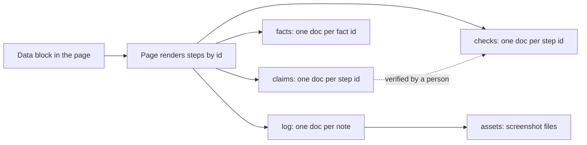

# Quest tracker: authoring guide

How to start and run a development season from the quest tracker template. The canonical copy of the template is [`quest-tracker.html`](../templates/quest-tracker.html), beside this guide in the `quest-tracker` skill; a copy published from it earlier may lag it. The pattern ran a client's whole launch season in October 2026 before it became this template.

## What the template is

One page that holds a whole season of work: phases of steps, each step opening into its lines to tick, a check, a stop, facts to write down, links, and a session log with screenshots. Everything on the page is drawn from **one data block** at the top of the page's script, between the `DATA BLOCK` and `END OF DATA BLOCK` markers. Edit that block and the rest follows:

- the "Waiting on you" strip at the top: claims ready for a check, and stops the work has reached
- the quest board (who does what, in order), the route strip and the "steps left to" counter, which names the goal
- open blocker tags and the "Stop and check in" stripes
- the season map, the burndown of steps left, the People panel, Next up and Recent activity
- the owner filter chips, the facts table and the reference sections

Ticks, claims, facts and notes are saved live in the artifact's shared database and seen by everyone who can open the page. Filters and which steps are open are remembered only in each viewer's own browser.

## Start a new project's tracker

1. Ask Claude: "start a quest tracker for the sourdough project", with whatever you already know (the goal, the people, the first phases). Claude takes the template from the `quest-tracker` skill.
2. Claude writes the new project's data block, with a new `storageKey` (for example `qt-sourdough`) so remembered filters do not mix between trackers, and runs the skill's script: `tracker.py fill` puts the block into the template and the tracker's name into the page's `<title>`, changing nothing else, and `tracker.py check` lists anything malformed (duplicate ids, a quest naming a step that does not exist, a step with nobody in `who`, a `storageKey` or title still the template's) before anyone sees it.
3. Claude publishes it as a **new** private artifact with the capabilities `db`, `user` (scope `profile`) and `assets`. Never publish over the template itself: each project gets its own artifact and its own database.
4. Open the new link. The yellow "Data block check" box under the header runs the same check as the script, so it shows nothing when the block is clean.
5. Share it from the page's Share menu: Editor for anyone who ticks or attaches screenshots, Viewer for anyone who only reads.

Doing it by hand also works: copy the template's HTML, edit the data block, leave `templateVersion` as copied, and publish the file as a new artifact with those three capabilities.

## The data block

| Field | What it holds |
|---|---|
| `LINK` | Base addresses (repository, docs folder, help sites) so step links stay short. |
| `templateVersion` | The template release the page's code came from, shown in the footer so a tracker on older code is easy to spot. Not project data: leave it as copied. It changes only when the code below the data block is replaced from a newer template. |
| `storageKey` | Prefix for each viewer's remembered filters. One per project. |
| `skin` | The default look: `zen`, `quest` or `field` (see "The three looks"). Each viewer can switch with the Look picker. |
| `ranks` | Rank titles, one per 100 XP, for the game skins. |
| `eyebrow`, `title`, `lede`, `statusNote` | The header: project line, page heading, how to use the page, and a dated status line. In `title`, `*word*` sets one word in the accent italic, like the "ship." on the Zen Solutions site. |
| `started` | First day of the season, `YYYY-MM-DD`. The burndown starts here. |
| `goal` | `{ label, target }`. The label finishes "steps left to ..."; the optional target date draws the even-pace line on the burndown. |
| `questsIntro` | The sentence above the quest board. |
| `doclinks` | Header buttons: `[label, url, small text]`. |
| `rules` | The rules strip: `{ title, text, warn }`. `warn: true` paints it as the "never" rule. |
| `people` | `key: { name, tone }`. Tone is one of `ink`, `accent`, `gate`, `done`, `plain`. |
| `phases` | The work, in order (below). |
| `quests` | The order of work across phases (below). |
| `reference` | Extra sections under the facts table: `{ title, text: [paragraphs], table: { head, rows } }`. |
| `footer` | The last line on the page. |

Text anywhere in the block understands five marks: `[[On-screen control]]`, `**bold**`, `*italic*`, `` `code` ``, and `[link text](https://...)`.

## The three looks

One token set, three skins, picked by `skin` in the data block and switchable per viewer (the Look picker in the toolbar, remembered in that viewer's browser):

| Skin | For | Look |
|---|---|---|
| `zen` | Zen Solutions work and professional projects (the default) | The Zen Solutions site palette: near-black, cream serif headings, vermilion accent, `//` eyebrows, a low red sun behind the header. With an 8-bit layer: pixel labels, notched corners, segmented progress bars, `LV` badges, square map cells. |
| `quest` | Main Quest Zen and anything playful | Main Quest Zen's look: night navy with a faint pixel starfield, heavy sans headings, pixel labels, cyan, amber and violet. |
| `field` | Client-facing trackers | The light work-order sheet, which follows the viewer's light or dark setting and drops the game layer. |

Both game skins are dark by design. The game layer adds a pixel burst and "+XP" when a step is ticked, and a "Quest complete" notice when the last step of a quest is ticked; both are skipped for anyone who has reduced motion switched on.

## XP and ranks

The game skins show season XP and a rank in the Season map panel. XP rewards writing things down as well as ticking:

| Action | XP |
|---|---|
| A step ticked | 10 |
| ...that is a blocker | +20 |
| ...that is a stop | +10 |
| A fact recorded | 5 |
| A note logged | 3, +2 with a screenshot |
| A claim from a Claude session | 0, until someone verifies it and ticks the step |
| A fact or a note a Claude session wrote | 0 |

Every 100 XP is a rank, named from `ranks`. XP is drawn from the saved ticks, facts and notes, so it is the same for everyone and goes down if a step is unticked. It never changes what a tick means: tick only checked work. XP is for the people on the page, which is why what a Claude session writes earns none: an agent filing notes would otherwise outrun everyone and make the ranks mean nothing.

## The season log, for the docs

The Reference section has a **Copy the log as Markdown** button: every phase and step with its state, its line count, its facts and its notes, dated, ready to paste into the project's docs or to hand to Claude at the end of a session. Where the viewer blocks copying, the text appears selected in a box instead.

## How to write a phase

```js
{ id: "p1", title: "Lock down the accounts", when: "Guide part A", now: true,
  intro: "One paragraph: what this stretch of work is, in what order, and what must be true at the end.",
  docs: "Which documents this phase changes",
  steps: [ ... ] }
```

`now: true` highlights the phase's `when` tag as the current one (`today: true`, from older hand-built run sheets, works too). A phase ends in something you can check.

## How to write a step

Every step carries its own context, so anyone can pick it up on any day without a call: **what** to do, **why** it matters, and **what closes it**.

```js
{ id: "p1-namecheap", t: "Lock the domain and turn on auto-renew", who: ["partner"],
  why: "The lock stops anyone with the password moving the domain away.",
  steps: [
    "At the registrar: [[Domain List]], [[Manage]], turn on [[Domain Lock]].",
    "Turn on [[Auto-Renew]]. The card is the owner's call.",
  ],
  check: "The public registry record lists `client transfer prohibited`.",
  stop: "anything asks you to [[Import]] or [[Reset DNS Records]].",
  tip: "If a record is changed by mistake: [[DNS history]], [[Restore]].",
  facts: [{ id: "domain_lock", label: "Domain Lock", hint: "on or off, and the date", placeholder: "On, 14 Oct" }],
  docs: [["Help: Domain Lock", "https://..."]],
  ours: [["Guide A2", LINK.GUIDE + "#a2"]],
  doc: "Inventory, Namecheap row" }
```

| Field | Use it for |
|---|---|
| `id` | The permanent key for the step's ticks, notes and facts. See the id rules below. |
| `t` | The title: a short imperative, the thing done. |
| `short` | A shorter name for the open-blockers line, when `t` is long. |
| `who` | Person keys from `people`. The first is whoever leads it. |
| `why` | One or two sentences: what goes wrong without it, and any decision already taken (with its date and who took it). |
| `steps` | The lines to follow, one click or one action each. Each line gets its own tick. |
| `check` | What proves it worked, observable by someone else ("asks for an app code", "answers 401"). This is what closes the step. |
| `stop` | Finishes the sentence "Stop if: ...". The condition that means do not go on. |
| `tip` | "Good to know": context that saves a wrong turn. |
| `facts` | Values to write down as you go (see below). |
| `docs` / `ours` | Links: vendor help pages, then the project's own docs. |
| `doc` | Which document to update after the step. |
| `gate: true` | A striped stop step: someone named in it must check in before anyone goes past. |
| `blocker: true` | Counts toward "N blockers open" until ticked, with a red tag on the board and the map. |
| `optional: true` | Shown dashed; never on the route, never warned about for a missing `why`. |

A step with neither `why` nor `check` is flagged by the data check: if you cannot say why it matters or what closes it, it is not ready to be a step.

## Ids

- Phase ids `p0`, `p1`, ... and step ids `<phase>-<word>`, such as `p3-ftp`. Letters, digits, `-` and `_` only.
- Fact ids are short snake_case names for the value, such as `ftp_cert_host`.
- **An id never changes once anything is ticked, logged or recorded against it.** The saved ticks, notes and facts are keyed by id: rename the id and they stay behind under the old one, invisible.
- An id need not match the phase it sits in. Moving a step to another phase is safe if the id stays (a step with the id `p2-org` can live in phase 1). Never reuse an old id for a different step.
- The data check flags duplicate step, fact and phase ids.

## Never move a step's lines

Line ticks are stored as a list by position (`subs: [true, false, true]`): the first tick belongs to line 1, the second to line 2, and so on. The list does not know the text of the line.

So, once any line of a step is ticked:

- **Add** new lines at the end only.
- **Never** insert a line above others, reorder lines, or delete one: every tick below it shifts onto the wrong line.
- **Reword** a line in place only if it still means the same action.
- If the lines must change shape, write a new step with a new id and mark the old one `optional`, with a `why` that says it was replaced.

The step-level tick (done or not) is safe: it is keyed by the step's id, not by position.

## Ticks: what they mean

A tick means the work is done **and** its `check` passed. Not started, half done, or "should be fine" stays unticked. A step can have every line ticked and still be open, because the step's own tick is the claim that it was checked. The burndown, the season map and the quest board all count only the step's own tick.

## Agents claim, people tick

A Claude session never ticks a step, not even one it finished. A tick written by the agent that did the work would be that agent checking itself, on a page people read as a record of checked work, and it would carry nothing anyone could check. So a session reports finished work as a **claim**, and a person checks it and ticks it.

A claim is one document in the `claims` collection, named by the step's id:

```js
{ agent: "go-live-check",                    // the session's name, shown as "Claude (go-live-check)"
  at: "2026-10-20T11:45:00Z",                // when it was claimed, ISO 8601 in UTC, from a real clock; also the claim's identity
  lines: [0, 1],                             // the lines it says are done, counted from 0 like the line ticks
  command: "python scripts/check_redirects.py --site https://example.com",   // exactly as typed
  result: "checked 42 old addresses\n42 redirect in one hop (301)\nexit status 0",  // the verbatim tail of what it printed
  note: "The test message is in the shared inbox, marked TEST." }
```

The command and its result are two fields, never one, and the result is what the command printed, never a summary of it. A claim with no command and no result says so on the page, because there is nothing to check it against. The skill's `tracker.py claim` builds the document by running the command itself: it keeps the command as given and the last lines of what it printed with the exit status, reads `at` from the clock, and refuses when the command fails or a field looks like a secret.

While a claim waits, the step is in its own amber state, **Ready for check**: a tag beside the title, a dashed amber tick box, an amber line under the title with the session and the time, the claimed lines marked, an amber cell on the season map, "ready for check" on the quest board, and a count of waiting claims beside the steps-left counter. Opening the step shows the claim at the top: the session, the time, the lines, the command, the result, the note, and the step's own `check` beside them.

An Editor settles it, after checking it themselves:

- **Verify and tick** ticks the step and the claimed lines, and records `verifiedClaim` (the claim's `at`) and `evidence` on the tick, so the step reads "verified from a claim by Claude (go-live-check)" and "checked by a command". Ticking the tick box of a claimed step does the same thing.
- **Send back** leaves the step open and records `declinedClaim` (the claim's `at`), `declinedBy` and `declinedAt`. The step shows "Sent back" with who and when. Log a note saying what is missing; the session can claim the step again once it is fixed, and its newer claim waits for a check again.

A claim also stops waiting when someone ticks or unticks the step by hand while the claim is on it: the tick records it as `settledClaim`, so a claim settled that way does not come back. Every one of these names the claim by its `at`, never by comparing times, because the session that wrote the claim and the browser that settles it keep different clocks. So a new claim needs a new `at`, and a claim whose `at` cannot be read as a time is ignored. Only Editors see the two controls; anyone else sees "An Editor checks this claim and ticks it."

Claims earn no XP until they are verified and ticked, and what a session writes down (facts, notes) earns none at all.

A session writes claims, notes and facts with an `agent` field carrying its name, and never writes `checks`. What a session writes never passes through the page's own save checks, because it goes straight into the database, so the page applies the same secret net when it shows it: a claim, note or fact value that looks like it holds a password, code or key is hidden, with a line asking the session to write it again without it, and so is a session name that looks like one. A hidden claim offers only **Send back**: with its command and result hidden there is nothing to check it against, so it cannot be ticked.

## What a tick rests on

Every ticked step says what its tick rests on, beside the "Done" line, on its season map cell, and in the season log:

| Mark | Saved as `evidence` | When |
|---|---|---|
| checked by a command | `command` | Verify and tick, on a claim that carried a command and that command's result |
| claimed, no command on record | `claim` | Verify and tick, on a claim that carried no command or no result |
| ticked by hand, no command on record | `hand` | the tick box, on a step with no claim waiting |

A tick by hand may rest on a person's own look at the screen, or on someone's word in a chat, and the page cannot tell which, so it says only what it has on record. That is not a reproach: plenty of steps close on something only a person can see. It is how a reader tells a checked command from a remembered one, and why a session that can run a step's check claims it rather than asking for a tick. While the verified claim is still the step's claim, the season log carries its command and result under the step. Ticks saved before template 1.2.0 have no `evidence`: the page reads them from `verifiedClaim` instead.

## What waits on you

The strip at the top of the page lists what needs a person. It appears once the saved ticks and claims have loaded, because what waits is worked out from them, and is hidden when nothing waits:

- **Check:** every claim still waiting, with the session that made it. Anyone can see it; an Editor settles it.
- **Stop:** every stop the work has reached, with who it waits on. A stop is reached when it is the first open step of a quest under way (the one up next, or one marked `wait`), or of the route when there are no quests. Optional steps are passed over. A stop that carries a waiting claim is listed under Check instead.

The strip leaves out what nobody can act on yet: a stop further down a quest waits until the steps before it are ticked.

## How ticks, claims, facts and logs are stored



| Collection | One document per | Fields |
|---|---|---|
| `checks` | step, named by its id | `done`, `by` (a person id), `at` (when last ticked or unticked), `subs` (line ticks by position), `note` (an older free-text note, shown as "Earlier note"), `evidence` (what the tick rests on: `command`, `claim` or `hand`), `verifiedClaim` (the `at` of the claim a tick verified), `settledClaim` (the `at` of a claim that was on the step when it was ticked or unticked by hand), `declinedClaim`, `declinedBy`, `declinedAt` (a claim sent back) |
| `facts` | fact, named by its id | `value` (300 characters at most), `by`, `at`, `step`, `agent` (when a Claude session wrote it) |
| `log` | note | `step`, `text` (4,000 characters at most), `asset` (a screenshot's id, or none), `by`, `at`, `agent` (when a Claude session wrote it) |
| `claims` | step, named by its id | `agent`, `at`, `lines` (positions, from 0), `command`, `result`, `note`; written only by Claude sessions |

Screenshots are uploaded to the artifact's asset store (Editors only) and shown from it. People are stored as opaque ids and their names looked up when the page renders, so a renamed account shows its new name. A Claude session is not a person on the page: it is named by its `agent` field and shown as "Claude (name)", beside the person when the document also names one. Claude reads every collection with the ArtifactData tool, which is how a session's results get copied into the project's docs at the end of a session. It writes claims, notes and facts, and writes `checks` only when the person asks it to seed example ticks or to copy a tracker's ticks across in a port.

The burndown is drawn from each route step's `at`. A step unticked and ticked again moves to its newer date; there is no separate history.

## What goes in facts

Facts are values someone will need again, written down while the screen is in front of them: names, places, settings and decisions that are safe to share.

- **Yes:** a folder path, a host name, a container or property ID, which login holds the domain, "on, 14 Oct", where the backup is kept, which phone holds the authenticator app, an expiry date, a yes or no answer to a question the step asks.
- **Never:** a password, sign-in code, backup or recovery code, API key, token, form key, card number, or anything a person could log in with. The page refuses a fact or note that looks like one (`password:`, a UUID-shaped key, `ghp_...`, `AIza...`, `sk_live_...`), but the check is a net, not a guarantee.
- Write the date and the person into the value when it matters ("Mon to Sat, 8 to 5, confirmed by the owner, 14 Oct").
- At the end of a session Claude copies the facts into the project's own docs (an inventory or playbook), so the tracker is never the only copy.

## Quests and the route

A quest is one run of work, in order, usually one call or one person's sitting. The `quests` list is the route to the goal:

```js
{ tone: "accent", short: "2 Partner call", title: "2. Partner call: accounts and hosting prep",
  note: "Who is needed, what to have ready, about how long.",
  wait: "Waiting on the owner",          // optional: the quest sits with someone else
  ids: ["p1-google", "p2-org", "p1-namecheap"] }
```

- The first quest not done and not waiting is marked "Up next". A quest with `wait` shows that label instead and is skipped for "Up next".
- The route is every step listed in any quest, in quest order. It drives "N steps left", Next up, the burndown, and the ringed cells on the season map. With no quests, the route is every step that is not optional.
- A step can sit in one quest only; listing it twice counts it once.
- `tone` picks the quest's color. `cls: "<person key>"`, from older hand-built run sheets, also works and borrows that person's color.

## The views

- **Waiting on you:** at the top, the claims ready for a check and the stops the work has reached, each opening its step.
- **Quest board and route strip:** the chain of runs, with progress bars, blocker tags, "ready for check" on claimed steps, and who is on each open step. Beside the steps-left counter, the open blockers and the claims waiting for a check.
- **XP and rank** (game skins): season XP, the rank, and the XP to the next rank.
- **Season map:** every step of every phase as one cell, in phase order. Green is done (hover a cell for what its tick rests on), solid amber a claim waiting for a check, red outline an open blocker, amber stripes a stop, dashed optional, a ring on the route. Each cell opens its step.
- **Steps left to the goal:** the burndown. One point per day from `started` to today, the dashed even-pace line to `goal.target`, and a hover read-out of the day's count and how many steps were ticked that day.
- **People:** one card per person: their steps done, their open blockers, their next step, and a button to filter the page to them.
- **Next up and Recent activity:** the next four route steps, and the last six ticks, claims, facts and notes with who and when.

## Ideas for more visualization, not built yet

Each of these reads only what the page already stores.

- **Blocker age:** how many days each open blocker has been open, from `started` or from the step's first note. Cheap; needs no new data.
- **Session calendar:** a heatmap of days with ticks and notes, which shows the season's rhythm and the quiet stretches. Cheap.
- **Dependency view:** a Mermaid flowchart from an optional `after: ["step-id"]` field on steps, showing which steps unlock which. Needs one new field.
- **True history:** an append-only `events` collection (one document per tick or untick) so the burndown never moves when a step is reticked. Needs a small change to the tick code; old trackers keep working without it.
- **Cross-project overview:** one page listing each project's tracker with its steps left and open blockers, read from each artifact's database by Claude at the end of a session. Needs a session routine, not a page change.

## Porting an existing sheet

A hand-built run sheet's `PHASES`, `QUESTS` and `OWNERS` move across almost unchanged: put `PHASES` into `phases`, `QUESTS` into `quests` (its `cls` still works), and turn `OWNERS` into `people` with a tone for each. Keep every id exactly as it was; the saved ticks stay in the old artifact's database, so a port is a fresh start unless Claude copies the documents across with ArtifactData.

## Bringing a tracker onto a newer template

A tracker keeps the code it was published with. To give it a newer template's code, Claude saves the tracker's page and runs `tracker.py fill --from` on it: the data block comes across unchanged except for `templateVersion`, which takes the newer template's value, and the page keeps its title. Then `tracker.py check`, a look at what the newer template changed in its sample `rules` and `reference` entries, and a republish to the tracker's **existing** artifact, so its database and every tick in it are kept. Template 1.1.0 added claims; 1.2.0 added the "Waiting on you" strip and the evidence marks, and needs nothing new in the data block; 1.2.1 changed only the sample data and one code comment.

## House rules

- No em-dashes; sentence-case headings, in the data block as anywhere else.
- Every step says what, why, and what closes it. No bare titles.
- Tick only verified work.
- Agents claim, people tick: a Claude session reports work as a claim, and someone else verifies it.
- Never move a step's lines once ticked.
- No secrets in notes, facts, claims or screenshots. Crop screenshots first.
