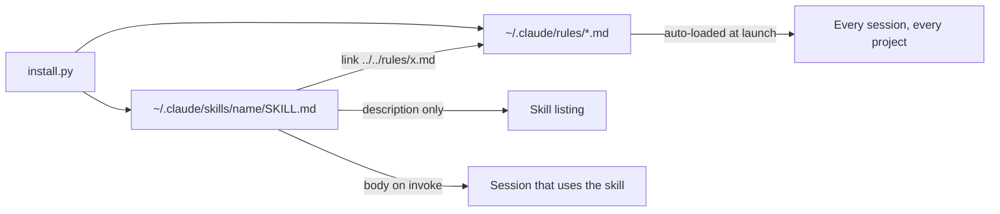
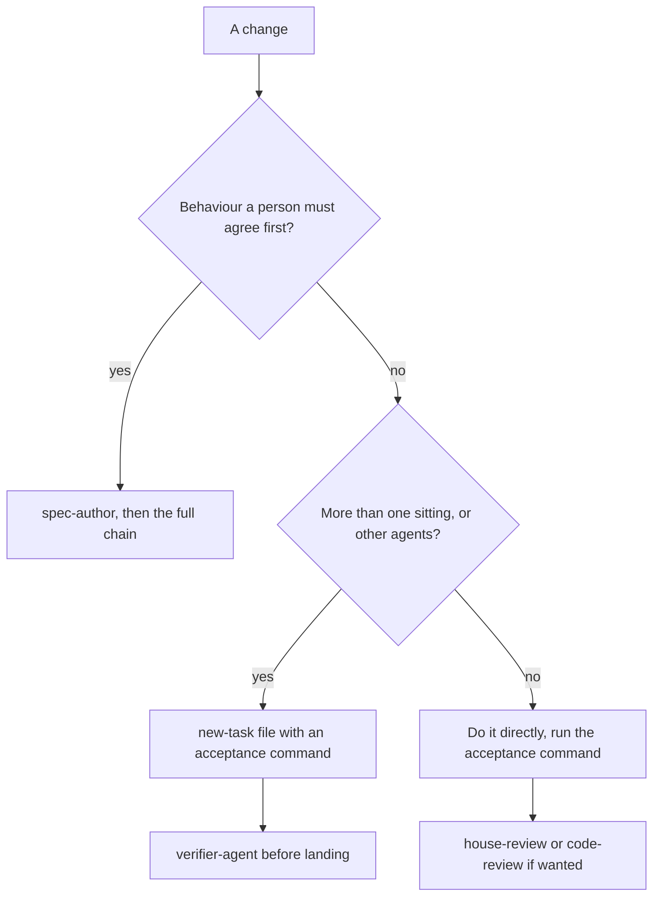
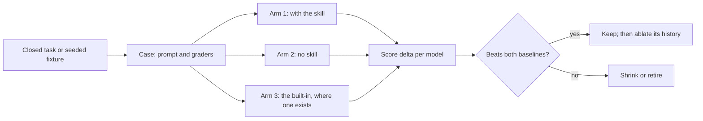
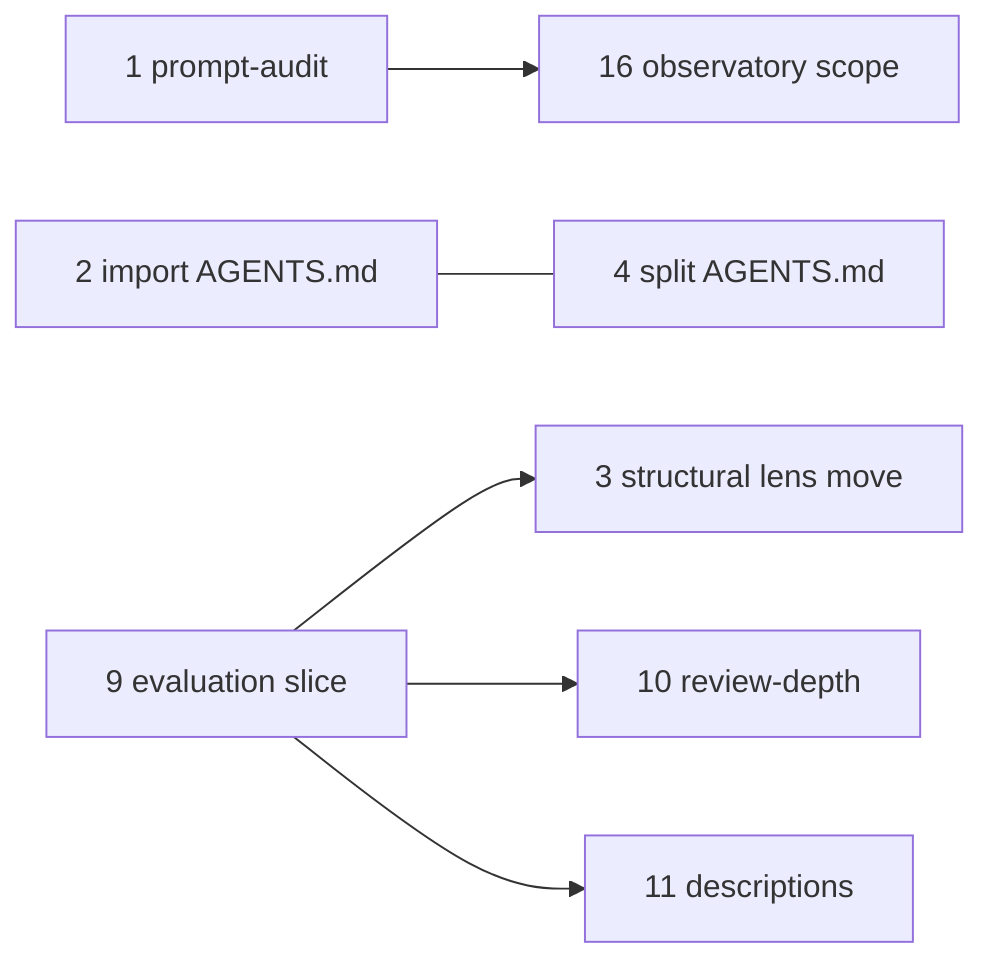

# Kit refresh audit, 2026-10-20

This report audits Zen Agent Skills against current Claude Code and Anthropic guidance, so the
maintainer can decide item by item what to cut, move, or keep before anything is rebuilt. It was
asked as analysis before building.

The audit pass was report only: no skill, rule, hook, or script was changed by it, and the commit
that adds this file adds nothing else. The scope was widened afterwards to implement the ranked
list, and later commits on the same branch do that, each mapped to a finding here in the pull
request.

## Verdict

**The kit's skills are in reasonable shape against current guidance. Its always-on footprint is
not, and most of that footprint is an accident of where the installer puts the lenses.**

Every skill body is under the 500-line guideline and every description is under the 1,024-character
cap. The skills are overwhelmingly procedure rather than history: outside `fix-batch`, no skill body
carries more than two lines citing a date, a task id, or an incident.

The weight is elsewhere. `install.py` places the three lenses in `~/.claude/rules/` so that each
skill's `../../rules/<file>.md` link resolves, and Claude Code loads every file in that directory
into every session, in every project on the machine. So 488 lines of lens text, about 5,550 words,
reach every session whether or not a skill ever runs, and more than three quarters of the largest
file is citation, incident history, and commentary about the rules rather than rule. A compact
always-on core is about one tenth of that.

The second structural finding is the `CLAUDE.md` pointer. Current documentation names this exact
shape, a `CLAUDE.md` that tells Claude in words to read `AGENTS.md`, and says Claude then sees
`AGENTS.md` only if it decides to open the file. The kit ships the same pointer to every repository
`init-worktracking` scaffolds.

The ranked list of proposed changes is at the end.

## Base, method, and coverage

**Base (`A9`).** This session's worktree was cut from `main` at
`fbc5a8f551df867c0bf7a36787212073ee678141`. `developer` was at
`ec1c1b3ced7cd67144485c2bc89125d4a8b8d6a4`, 32 commits ahead of `main` across 89 files, including the
whole sitrep build and the 255-line `AGENTS.md` the brief describes (`main` carries 230 lines). The
branch had no commits of its own, so it was reset to `developer` before any measurement was taken.
Every figure below is at `ec1c1b3` unless it names another path.

**Installed copies.** The three files in `~/.claude/rules/` were compared byte for byte with
`.agents/rules/` at `ec1c1b3` and are identical, so the always-on figures are the repository's
figures. `~/.claude/CLAUDE.md` is not placed by `install.py` (nothing in
[`scripts/install.py`](../../scripts/install.py) writes it), but it loads alongside the rules and is
measured with them.

**Documentation.** Anthropic pages were fetched on 2026-10-20 as raw Markdown (the `.md` form of each
`code.claude.com/docs/en/<page>` URL, and the platform best-practices page), and every quotation
below was copied from those files rather than from a summarized fetch. Two research subagents
gathered the built-in feature facts in section 3 and the hook facts in section 4, and their
load-bearing claims were re-checked against the raw pages before use.

**Citation check (`A7`).** A separate agent, not the author, resolved every repository citation and
recomputable figure in this report against the tree: 82 checked, 75 matched, 3 re-anchored to the
lines the text actually occupies, and 4 corrected (a byte count, a quotation's wording, a commit for
a moving branch, and a file that had changed state since it was observed). All seven fixes are in
this version. Documentation quotations were outside that check and were verified by the author
against the raw pages instead.

**What was checked:** every skill directory under `.agents/skills/` at `ec1c1b3`, the three lenses,
the hooks module, `AGENTS.md`, `CLAUDE.md`, the `init-worktracking` templates, the install profiles
(by `install.py --dry-run` into a scratch home), and the sitrep spec chain.

**What was not checked:** the behaviour of any skill on a model (section 7 proposes how, and runs
nothing); the Cursor, Copilot, Codex, and opencode adapters; the observatory; and the quest-tracker
skill's content, which has not landed on `developer` (it exists only on
`zen/quest-tracker-skill-157c86`, read-only here for its two sizes at `15e1c74`, the branch tip when
measured).

## 1. Always-loaded weight

### What loads, and from where

The memory page states the rule for `~/.claude/rules/` directly:

> "Rules without `paths` frontmatter are loaded at launch with the same priority as
> `.claude/CLAUDE.md`."
> ([memory](https://code.claude.com/docs/en/memory))

and, for the user-level directory, "Personal rules in `~/.claude/rules/` apply to every project on
your machine." The same page sets the size target this audit was asked to measure against:

> "target under 200 lines per CLAUDE.md file. Longer files consume more context and reduce
> adherence."

It also says where task-specific material belongs instead: "For task-specific instructions that don't
need to be in context all the time, use skills instead, which only load when you invoke them or when
Claude determines they're relevant to your prompt."



The installer's own docstring records why the lenses go there, and the reason is link resolution
alone:

> "That location is not arbitrary: a skill body references its lens as ../../rules/<file>.md, which
> resolves from <base>/<skill-name>/SKILL.md to exactly this directory."
> ([`scripts/install.py`](../../scripts/install.py), lines 55 to 59)

Nothing in the kit records that Claude Code also treats that directory as always-on memory. A search of
every Markdown file for `~/.claude/rules` or "every session" finds only installer bookkeeping and hook
cost notes. The 2026-09-01 review measured the description budget as "always-resident context"
([`2026-09-01-optimization-and-gap-review.md`](2026-09-01-optimization-and-gap-review.md), the
section on the default install) and did not count the lenses, which are larger.

### The measurement

| File | Lines | Words | Bytes | Operative share of words |
| --- | --- | --- | --- | --- |
| `~/.claude/rules/autonomy.md` | 258 | 3,124 | 18,649 | 23% |
| `~/.claude/rules/review-quality.md` | 207 | 1,977 | 12,939 | 79%, all of it topical |
| `~/.claude/rules/house-style.md` | 23 | 455 | 2,795 | 51% |
| `~/.claude/CLAUDE.md` | 20 | 205 | 1,374 | 100% |
| **Total** | **508** | **5,761** | **35,757** | |

At roughly four bytes per token, an estimate rather than a count, that is about 9,000 tokens in every
session on this machine before the first prompt, plus the skill listing and the project's own files.
`autonomy.md` alone is over the 200-line target and `review-quality.md` is near it; together the four
files are two and a half times it.

The split was made by block, using markers in the files themselves, with a script kept outside the
repository:

- **`autonomy.md`**: a rule runs from its bold `**An.` headline to the line before its `*Cited`
  paragraph, and is operative; the `*Cited` paragraph is history. The principle quote is operative.
  Everything else is meta: the opening (lines 1 to 30), "Why every rule here carries a citation"
  (lines 53 to 85), "Considered for v1 and held" (lines 229 to 249), and the closing scope section.
  Result: operative 47 lines and 703 words; citations 71 lines and 1,013 words; meta 1,408 words. The
  operative figure is generous, because `A9`'s headline carries a 60-word parenthetical about id
  ordering (lines 191 to 195) that is meta.
- **`review-quality.md`**: the severity scheme through the review protocol (lines 16 to 171) is
  operative; the opening, the scope section, and the two provenance blocks (lines 182 to 207) are not.
  The operative part also holds rationale, such as "Drift is a pointer problem" at line 107.
- **`house-style.md`**: the six bullets (lines 9 to 19) are operative, except that the row-count
  bullet at line 14 spends 70 of its 144 words on four incident citations.

### Findings

**1.1 (major) Every lens is always-on, including the one the kit calls topical.** `AGENTS.md` says
`review-quality.md` "is topical and is composed only by the skills that review"
([`AGENTS.md`](../../AGENTS.md), lines 113 and 114). It is composed by four skills. It loads into every
session on the machine, including sessions in unrelated repositories that never review anything. The
cause is the placement described above, not anything in the lens.

The lenses' own model of how they reach an agent is the reverse of what happens in Claude Code. Both
universal lenses say "A lens reaches an agent only through a skill that points at it"
([`autonomy.md`](../../.agents/rules/autonomy.md), lines 20 and 21; the same sentence in the scope
paragraph of [`house-style.md`](../../.agents/rules/house-style.md)). Installed for Claude Code, a
lens reaches every agent whether or not any skill points at it, and the validator rule that makes
every skill name every universal lens (`AGENTS.md`, lines 107 to 121) buys nothing there. It still
buys something for harnesses that do not auto-load the directory, which is the reason to keep it.

**1.2 (major) The always-on autonomy lens is more than three quarters citation and commentary.** Its own preamble argues that
every rule must carry a citation so an invented rule cannot pass as a consolidated one
([`autonomy.md`](../../.agents/rules/autonomy.md), lines 53 to 62). That argument is about how a rule
is admitted, and it is sound. It does not require the citation to ride in every session's context:
the citation's reader is a maintainer deciding whether the rule is real, not an agent deciding what to
do next.

**1.3 (minor) Task-id citations in the always-on lenses resolve nowhere outside this repository.**
The three lenses mention 17 task ids between them (`autonomy.md` 10, `house-style.md` 5,
`review-quality.md` 2), plus prose references to `ROADMAP.md` Epic E, `SECURITY.md`,
`scripts/install.py`, and `scripts/check-provenance.py`. In every other project they name nothing, and
an agent that takes a citation as a lead goes looking for files that do not exist.

**1.4 (minor) The user CLAUDE.md and `house-style.md` repeat four rules and contradict on one.** Both
load in every session. They agree on no em-dashes, sentence-case headings, named sources, and Mermaid.
They disagree on links:

- `~/.claude/CLAUDE.md`, line 10: "Link to files and code symbols with clickable `file://` links".
- [`house-style.md`](../../.agents/rules/house-style.md), line 18: "Link to files and code symbols
  with clickable relative links so they resolve inside the repository."

The memory page is explicit about what happens next: "if a user rule and a project rule conflict,
Claude may follow either one". Here both are user scope, so neither has even the ordering advantage.

### A compact always-on core

| Part | Today | Proposed always-on | Where the rest goes |
| --- | --- | --- | --- |
| Autonomy | 258 lines, 3,124 words | about 25 lines, about 380 words: the principle, one line of scope (`A1` to `A9` unattended, `A10` always), and each rule's headline plus one sentence | the full lens, read on demand by the skills that already link to it |
| Review quality | 207 lines, 1,977 words | none | the full lens, read by the reviewing skills as now |
| House style | 23 lines, 455 words | about 8 lines, about 120 words, merged into `~/.claude/CLAUDE.md` with the link rule settled one way | the full lens, with its incident tail |
| User `CLAUDE.md` | 20 lines, 205 words | unchanged apart from the merge | |
| **Total** | **508 lines, 5,761 words** | **about 50 lines, about 700 words** | |

That is roughly an 88 percent cut in always-on words with no rule text lost, because every operative
sentence stays reachable through the skills that compose it. The mechanism is the open question, and
section 8 ranks the options.

## 2. `/doctor prompt-audit`

### It could not run from this session

| Check | Result |
| --- | --- |
| `claude --version` (the CLI on `PATH`, `~/.local/bin/claude`) | `2.1.232 (Claude Code)` |
| Required by the memory page | "`/doctor prompt-audit` requires Claude Code v2.1.283 or later." |
| The desktop app's bundled CLI (`CLAUDE_CODE_EXECPATH`) | `2.1.299 (Claude Code)`, new enough |
| `claude -p "/doctor prompt-audit"` with the bundled CLI, plan mode, file-writing tools denied | exit 1, stdout `Failed to authenticate: OAuth session expired and could not be refreshed` |
| `claude -p "/skill-doctor"`, same invocation | exit 1, the same line |

The nested CLI cannot reuse the desktop session's sign-in, and signing in is the maintainer's to do.
The page describes the audit as report-only ("nothing in your files changes until you ask Claude to
apply them"), so it is safe to run as written:

```bash
claude update
```

then, in an interactive `claude` terminal in this repository, `/doctor prompt-audit` and
`/skill-doctor`. The second needs v2.1.252 or later and, per the
[skills](https://code.claude.com/docs/en/skills) page, "flags skills in the listing that have never
been invoked".

### A manual pass over the same three classes

The memory page names what the audit looks for: "instructions written for older models, references to
files or commands that don't exist, and files that contradict each other." The candidates below are a
by-hand approximation of those classes, offered as findings to judge rather than to apply, and they are
not a substitute for the real run.

**2.1 Written for older models: "should be a little pushy".** [`AGENTS.md`](../../AGENTS.md), line 65,
says a description "should be a little pushy (agents under-trigger skills)". The current
best-practices page does not carry that advice (a search of it for "pushy", "aggressive", and
"under-trigger" returns nothing); what it asks for is third person, specificity, and the key use case
first. The skills page now adds a reason the advice costs more than it did: when the listing overflows
its budget, "Claude Code drops descriptions starting with the skills you invoke least". About half the
Zen descriptions run between 843 and 963 characters, and four Zen skills appeared in this session's own skill
listing by name with no description at all: `house-review`, `project-bootstrap`, `review-depth`, and
`test-quality`.

**2.2 References that do not exist: the citations in finding 1.3.**

**2.3 Contradictions.**

- The link rule in finding 1.4.
- The commit trailer. [`AGENTS.md`](../../AGENTS.md), lines 201 to 205, forbids a `Co-Authored-By`
  trailer naming a model. The harness default is the opposite (commits "get a git trailer such as
  `Co-Authored-By` by default", per the
  [settings reference](https://code.claude.com/docs/en/settings-reference)), and this session's own
  system reminder said to end commit messages with a `Co-Authored-By: Claude` line. Precedence resolves
  it correctly today, because the repository's instruction wins, but every commit by every agent here
  carries the contradiction, and the `attribution` setting would remove it at the source (section 4).
- `A3`'s headline, "Never overwrite a file you did not create", reads as universal in a file that loads
  into attended sessions too. The scope that limits it to unattended runs is stated in the opening
  paragraph (lines 5 and 6), with `A10` carved out of it at line 14. In an always-on file the headline
  is what an agent weighs, and the scope sits about a hundred lines above it.

## 3. Per-skill measurements and overlap with built-ins

### Size against the guidance

The [best-practices page](https://platform.claude.com/docs/en/agents-and-tools/agent-skills/best-practices)
says "Keep SKILL.md body under 500 lines for optimal performance". The Claude Code
[skills](https://code.claude.com/docs/en/skills) page caps each entry in the listing at 1,536
characters, and the kit's validator enforces the stricter 1,024 of the Agent Skills specification
([`validate-skills.py`](../../scripts/validate-skills.py), line 65).

Body lines exclude frontmatter. "History lines" counts body lines that cite a date, a task id, or an
incident, as a rough density signal.

| Skill | Status | Body lines | Description chars | History lines | Nearest built-in | What the skill does that the harness does not |
| --- | --- | --- | --- | --- | --- | --- |
| `agent-handoff` | shipped | 79 | 853 | 1 | `/fork`, `/subtask`, the desktop hand-off | a written, self-contained brief that survives a change of model, harness, or person |
| `agent-observatory` | draft | 135 | 917 | 0 | agent view, `/skill-doctor` | cost, failures, and skill use across every project, from a local store |
| `doc-author` | shipped | 46 | 938 | 1 | `/init` (a `CLAUDE.md` only) | code-grounded READMEs, architecture docs, and decision records |
| `doc-revise` | shipped | 37 | 942 | 0 | none | in-place revision that keeps the document's voice, and link repair after moves |
| `doc-sync` | shipped | 310 | 956 | 0 | none | drift detection by document class, dry run by default, contract documents never edited |
| `fix-batch` | shipped | 468 | 944 | 10 | `/batch`, `isolation: worktree`, agent teams | works pre-authored task files, pins the base, demands a fixed report, verifies every item independently, publishes nothing |
| `house-review` | shipped | 227 | 873 | 1 | `/code-review`, `/security-review`, ultrareview | a swappable rubric, a quote-resolving evidence gate, stable signatures, report only, harness-neutral |
| `human-handoff` | shipped | 53 | 931 | 0 | none | a reader-tuned update for a partner, client, or teammate |
| `init-worktracking` | shipped | 173 | 874 | 0 | `/init` | `AGENTS.md`, `.tasks/`, and `validate.py` in three tiers |
| `new-task` | shipped | 139 | 860 | 0 | the agent-teams task list | durable, validated task files with an acceptance command, readable by any harness |
| `pr-describe` | shipped | 182 | 777 | 1 | none as a command | a changelog line in the repository's own format and an issue-closing reference, as a draft |
| `project-bootstrap` | shipped | 101 | 647 | 0 | `/init` | a stack-matched baseline (ignore files, editor config, linter, licence) |
| `reconcile-worktrees` | shipped | 248 | 770 | 2 | the worktree exit prompt and periodic sweep | landing worktree work in the main checkout; the docs describe keep, remove, and sweep, and no merge path |
| `review-depth` | shipped | 359 | 836 | 1 | `/code-review` levels `low` to `max` and `ultra` | a stated signal table and rule for picking the depth |
| `sitrep` | draft | 100 | 801 | 0 | agent view, `/tasks`, `/recap` | a per-repository board from its own records, with an evidence tier on every figure |
| `spec-author` | shipped | 189 | 611 | 0 | plan mode | a durable scenario spec with stable `S-NNN` ids |
| `spec-conformance` | shipped | 68 | 542 | 2 | none | a conformance matrix with a coverage proof |
| `spec-plan-readiness` | shipped | 189 | 524 | 2 | none | a go or no-go gate over a spec and its tasks |
| `spec-quality` | shipped | 216 | 370 | 2 | none | the spec well-formedness lens |
| `systematic-debugging` | draft | 349 | 963 | 1 | none | reproduce-first diagnosis with a deterministic verdict |
| `test-author` | shipped | 149 | 759 | 0 | none | one test per scenario, tagged with its id |
| `test-quality` | shipped | 179 | 467 | 2 | none | the test layer and oracle lens |
| `verifier-agent` | shipped | 223 | 843 | 1 | `/goal`, Stop and agent hooks, `/verify` | runs the declared commands itself, maps each criterion to named evidence, composes conformance, returns pass, fail, or blocked |

The built-in descriptions are from the [commands](https://code.claude.com/docs/en/commands) page
unless noted. Draft status is the `metadata.status: draft` marker, which `install.py` honours by
placing the skill in no profile.

**3.1 (pass) Every skill is inside both limits.** The closest to the line-count guideline is
`fix-batch` at 468 body lines; the longest description is `systematic-debugging` at 963 characters.

**3.2 (minor) The descriptions are the part that grows the always-on cost.** The default `spine`
profile places 18 skills and 13,533 description characters; `all` places 20 and 15,317
(`install.py --dry-run`, 2026-10-20). The listing budget "scales at 1% of the model's context window"
([skills](https://code.claude.com/docs/en/skills)) and is shared with every other installed skill and
plugin, and on this machine that is a long list.
Trimming descriptions to the key use case first and the trigger phrases second, as the skills page
asks, is cheaper than any body change.

**3.3 (info) The quest-tracker skill has not landed.** On its branch at `15e1c74` it is 260 lines (239
body) with an 849-character description, inside both limits. The branch is still moving: at the
earlier `7109746` the same file was 245 lines. It is excluded from everything else here.

### Overlap with built-in features

**3.4 (major) `review-depth` now duplicates a built-in argument.** Its job is choosing quick,
standard, or deep review. `/code-review` takes `low`, `medium`, `high`, `xhigh`, `max`, or `ultra`
directly, and "With no level given, the review reuses the last `low` through `max` level you typed"
([commands](https://code.claude.com/docs/en/commands), the `/review` row). What `review-depth` still
adds is an auditable reason for the depth: the signal table and the rule that fired. That is real, but
it is 359 body lines, the second-largest skill, for a choice the built-in now makes in one word. A
candidate for retirement, or for shrinking to a short section of `house-review` that maps its rule
onto the built-in levels when running in Claude Code.

**3.5 (major) `fix-batch` documents, as incident history, a harness behaviour the docs now state as a
setting.** The skill's Claude Code section says `isolation: "worktree"` "has cut worktrees from
`origin/main` while the dispatch branch was `developer`, three times on record, and it gives you no
place to name a base" ([`fix-batch`](../../.agents/skills/fix-batch/SKILL.md), lines 436 to 440), and
Step 3 spends lines 146 to 212 on pinning and recovering the base. The
[worktrees](https://code.claude.com/docs/en/worktrees) page now says why: subagent worktrees "branch
from your repository's default branch unless `worktree.baseRef` is set to `"head"`", and "You can't
set `worktree.baseRef` to a branch name." Setting `worktree.baseRef: "head"` in the committed project
settings would remove the cause for Claude Code. The explicit `git worktree add <path> <sha>` path
stays as the harness-neutral method, and the incident narrative can move out of the body.

`/batch` itself is a different tool rather than a replacement: it "decomposes the work into 5 to 30
independent units" from an instruction, and "Each subagent implements its unit, runs tests, and
publishes its change." `fix-batch` starts from task files a person already approved, publishes
nothing, and its value is the per-item independent verification `/batch` does not describe. The
honest comparison is an evaluation (section 7), not a reading.

**3.6 (info) `verifier-agent` complements `/goal` rather than competing with it.** `/goal` "is a
wrapper around a session-scoped prompt-based Stop hook", and its evaluator "doesn't run commands or
read files independently" ([goal](https://code.claude.com/docs/en/goal)). `verifier-agent` is the
opposite shape: it runs the declared commands and reads the files. The two compose: a goal condition
of the form "verifier-agent returned pass for feat-NNNN" keeps an agent working until an independent
check agrees. Agent hooks (`type: "agent"`, experimental per the
[hooks](https://code.claude.com/docs/en/hooks) page) are the nearest built-in to a verifier, and would
be worth an experiment once the skill has a baseline evaluation.

**3.7 (info) `reconcile-worktrees` has no built-in equivalent.** The worktrees page documents keep,
remove, and a periodic sweep that "removes worktrees that Claude created for subagents and background
sessions once they are older than your `cleanupPeriodDays` setting", keeping any that still hold
changed or untracked files or unpushed commits. It documents no route for landing a worktree's work in
the main checkout other than `/batch` publishing its own. One addition worth a line in the skill: the
sweep means an abandoned subagent worktree is not permanent.

**3.8 (info) The two draft skills about sessions should be scoped against what shipped.** Agent view
("one screen for all your background sessions", research preview per
[agent view](https://code.claude.com/docs/en/agent-view)) and `/skill-doctor` (per-skill context cost
and use) now cover part of `agent-observatory`'s stated ground. `sitrep` reads a repository's records
(tasks, worktrees, branches) rather than sessions, which no built-in does, so it overlaps least. Its
state, as asked, without building anything: the spec is approved with 40 scenarios, its conformance
matrix records 28 conformed, 0 diverged, and 12 not-built
([`sitrep.conformance.md`](../spec/sitrep.conformance.md), lines 31 and 32), `feat-0066` to
`feat-0069` are in `.tasks/done/`, and `feat-0070` and `feat-0071` are open.

**3.9 (info) Agent teams do not replace the task-file layer.** They are "experimental and disabled by
default", coordinate through a shared task list and a mailbox, and the page warns that "Two teammates
editing the same file leads to overwrites" with no worktree isolation described
([agent teams](https://code.claude.com/docs/en/agent-teams)). The kit's `touched_files` discipline in
`new-task` is exactly what that warning asks for.

## 4. Rules that would be better as hooks

The memory page puts the boundary plainly: memory is "context, not enforced configuration. To block an
action regardless of what Claude decides, use a PreToolUse hook instead." The kit's
[hooks module](../../.agents/hooks/README.md) already has the right test for which shape a rule takes:
"could a careful person disagree with the hook about whether the condition holds? If yes, it is a
reminder." The hooks page adds one more boundary worth keeping: the `if` filter is best-effort, so
"use the permission system rather than a hook to enforce a hard allow or deny"
([hooks](https://code.claude.com/docs/en/hooks)).

| Rule | Written at | Decidable from the payload? | Proposed mechanism |
| --- | --- | --- | --- |
| No em-dashes | [`house-style.md`](../../.agents/rules/house-style.md), line 11 | Presence, yes; legitimacy, no | `PostToolUse` reminder on `Write` and `Edit`, naming the file and line |
| `A1`, shell writes outside the worktree | [`autonomy.md`](../../.agents/rules/autonomy.md), lines 88 to 92 | Only for a subset | `PreToolUse` reminder on `Bash` and `PowerShell`; a sandbox where one runs |
| No `Co-Authored-By` trailer | [`AGENTS.md`](../../AGENTS.md), lines 201 to 205 | Yes | the `attribution` setting, not a hook |
| `A8`, never merge your own work | [`autonomy.md`](../../.agents/rules/autonomy.md), lines 217 to 219 | Yes, for the commands that merge | a `permissions.deny` rule in unattended configurations |
| `A9`, verify the base | [`autonomy.md`](../../.agents/rules/autonomy.md), lines 191 to 200 | The comparison, yes; the right base, no | `worktree.baseRef: "head"`, plus a `SessionStart` reminder in a worktree |
| `A10`, material you did not author | [`autonomy.md`](../../.agents/rules/autonomy.md), lines 122 to 128 | No | a reminder at ingestion, as the 2026-09-01 review proposed |

**4.1 Em-dashes.** Whether a write contains U+2014 is decidable from `tool_input.content` or
`new_string`. Whether it should is not: the repository holds two em-dashes today and both are
legitimate, one in a test that asserts a skill body carries none
([`tests/test_systematic_debugging.py`](../../tests/test_systematic_debugging.py), line 774) and one
in a closed task file. A gate would have blocked writing that test. So the shape is a reminder that
names the file and line, plus, for this repository's own documents, a check in `run-checks.py`, which
has no em-dash gate today (a search of `scripts/` finds none). No tool hook reaches an em-dash in a
chat reply or a drafted message; the global rule covers those and the hook should not claim to.

**4.2 The `A1` gap is wider on this machine than the kit assumes.** The worktrees page says of its
isolation checks: "None of them tracks which files a shell command writes, so a command that writes
into the main checkout without running git there, such as `cp` or a shell redirect, isn't refused by
them", and "For PowerShell commands, Claude Code applies only the working-directory check." The
sandbox that would bound shell writes "is off by default", and "On native Windows, Claude Code runs
commands unsandboxed" ([sandboxing](https://code.claude.com/docs/en/sandboxing)). This machine is
native Windows with PowerShell as its primary shell, so nothing documented stops a shell write from a
worktree into the main checkout here.

What the built-ins do cover: "Claude Code blocks an `Edit`, `Write`, or `NotebookEdit` that targets a
path in the main checkout." So the hook's job is shell commands only. A command's write targets are not
decidable from its text (variables, scripts, `cd`), so a gate would both miss and false-block. The
shape is a `PreToolUse` reminder on `Bash` and `PowerShell` that fires when the command text names an
absolute path outside the hook input's `cwd`. It must read `cwd`, because "`${CLAUDE_PROJECT_DIR}`
stays put" in a worktree and still points at the main checkout. For unattended runs the real boundary
is a sandbox (WSL2 on Windows) or a container, which the sandboxing page names for exactly this:
"run the Claude Code process itself in a container, virtual machine, or the sandbox runtime."

**4.3 The co-author trailer is a setting, not a hook.** The settings reference says commits get a
`Co-Authored-By` trailer "by default", and that `attribution.commit` set to an empty string hides it
([settings reference](https://code.claude.com/docs/en/settings-reference)). Setting that in the
committed [`.claude/settings.json`](../../.claude/settings.json) removes the default at the source,
for every session in this repository, including cloud sessions, which is the reason that file is
committed at all. `AGENTS.md` scopes its committed-file exception to hooks ("Adding a second hook to
that file ... is a new decision", line 193), so a non-hook key is arguably inside it, but it is a
change to a file every collaborator inherits and should be the maintainer's call. It would not touch `chore-0090`,
whose trailers come from Copilot Autofix rather than Claude Code.

**4.4 `A8` is a permission rule.** "Never merge your own work" is decidable for the commands that
merge (`gh pr merge`, a push to `main` or `developer`). The hooks page's own advice puts a hard deny in
the permission system. A deny rule in the settings an unattended run uses is the enforcement; the rule
text stays as the reason.

**4.5 `A9` loses its main cause to `worktree.baseRef`.** See finding 3.5. What remains decidable is the
comparison between a worktree's `HEAD` and the integration branch, which a `SessionStart` reminder can
report. Which branch is right stays a judgment, so it is a reminder.

**4.6 (major) The kit's own delegation reminder fires at the wrong moment for background agents.**
Observed in this session: [`delegation-reminder.py`](../../.agents/hooks/delegation-reminder.py)
injected "a delegated agent just returned a report" immediately after each of three background
`Agent` launches, when nothing had returned. When those agents did return, each report arrived as a message
rather than a tool result, and no reminder fired for any of them. The hook checks only the event name and the
tool name (`evaluate()`, lines 81 to 94) and never reads `tool_input.run_in_background`. It is right
for a foreground delegation and wrong in both directions for a background one, which is how `fix-batch`
dispatches. The fix for the false positive is decidable from the payload. For the missed return, no
parent-side event was found in the documentation for a background agent's report; `SubagentStop`
output goes to the subagent, not the parent ("keeps the subagent running", per the hooks page), so it
is not the answer.

Rules that stay prose: `A2` and `A4` to `A7` are judgments about scope, evidence, and independence, and
the sentence-case and Mermaid rules have too many legitimate exceptions to gate.

## 5. The spec chain's weight for small tasks

### What the full chain costs

The collaboration loop in [`GETTING-STARTED.md`](../GETTING-STARTED.md) (the flowchart at line 315)
runs `spec-author`, a human approval, `new-task`, the work, `test-author`, `spec-conformance`,
`verifier-agent`, `house-review`, `doc-sync`, and `pr-describe`. The most recent feature built this
way is the sitrep, still in progress, which is a fair sample because it is current and went through
the spec, readiness, decomposition, and conformance steps as designed:

| Artifact | Lines | Words |
| --- | --- | --- |
| Spec, readiness gate, conformance matrix (`docs/spec/sitrep*.md`) | 696 | 6,690 |
| Task files `feat-0066` to `feat-0071` | 556 | 4,397 |
| **Contract and task prose, together** | **1,252** | **11,087** |
| Implementation (`.agents/skills/sitrep/scripts/sitrep.py`) | 805 | code |
| Tests (`tests/test_sitrep_*.py`) | 1,036 | code |

About one and a half lines of contract and task prose per line of implementation. For a feature with
40 behavioural scenarios and a person's watermark to get right, that may well have earned its place.
For a one-file fix it would not, and the question asked was whether a light path exists.

### Whether a light path exists

It exists in pieces and is not stated as a path anywhere:

- **Adopters get a light lifecycle already.** The shipped template's lifecycle is five steps with no
  `doc-sync` and no conformance
  ([`AGENTS.md.tmpl`](../../.agents/skills/init-worktracking/templates/AGENTS.md.tmpl), lines 49 to
  58), the `spec` and `scenarios` fields are optional ("Omit both when there is no spec",
  [`new-task`](../../.agents/skills/new-task/SKILL.md), line 28), and `init-worktracking` has a lite
  tier.
- **This repository does not.** Its own lifecycle adds a `doc-sync` pass over the reader-facing
  documents to every task closeout, conformance when a spec is declared, link re-anchoring, a changelog
  line, and a roadmap strike ([`AGENTS.md`](../../AGENTS.md), line 53).
- **Each skill points away from itself for small work, separately.** `fix-batch`: "Do not use it for a
  single fix (just do it directly)" (line 11). `new-task`: "Do not skip it for anything non-trivial"
  (line 35), without saying what trivial is. The getting-started guide has a "light-touch path" (line
  292), which is about adopting single skills rather than about sizing a change.

**5.1 (minor) No single rule says which path a change takes.** An agent arriving at a small change
meets the full loop in the guide and the separate hints above, and has to infer the light path. A short decision rule, in the README and the shipped `AGENTS.md` template, would make the
light path the default rather than the exception:



The thresholds are the maintainer's to set. The point is that the light path is named and is the
default for the smallest class, so the full chain is something a change earns.

## 6. `CLAUDE.md`, `AGENTS.md`, and the import

### The pointer is the documented anti-pattern

The memory page tabulates what Claude reads for each combination of files. For "An `AGENTS.md` and a
`CLAUDE.md` or `CLAUDE.local.md` in your working directory or above it", the answer is "Your
`CLAUDE.md` files only". Its section on earlier workarounds names this kit's exact shape:

> "A `CLAUDE.md` that tells Claude in words to read `AGENTS.md`: Claude sees `AGENTS.md` only if it
> decides to open the file. Delete the `CLAUDE.md` so Claude reads `AGENTS.md` directly, or replace
> the sentence with an `@AGENTS.md` import."
> ([memory](https://code.claude.com/docs/en/memory))

[`CLAUDE.md`](../../CLAUDE.md) is that sentence: "Read that file, not this one." This session is the
evidence. Its starting context carried the three lines of `CLAUDE.md` and none of `AGENTS.md`, which
reached it only through a `Read` call this session chose to make.

**6.1 (blocker) The kit ships the same pointer to every repository it scaffolds.**
[`CLAUDE.md.tmpl`](../../.agents/skills/init-worktracking/templates/CLAUDE.md.tmpl) is byte-for-byte
the same three lines, `init-worktracking` leaves an existing prose pointer in place ("if it already
points at `AGENTS.md`, leave it",
[`init-worktracking`](../../.agents/skills/init-worktracking/SKILL.md), line 108), and the
portability contract still says "a thin `CLAUDE.md` pointer covers Claude Code"
([`AGENTS.md`](../../AGENTS.md), line 144). Under current Claude Code that sentence is false as
worded: the pointer covers Claude Code only when the model decides to follow it. It is graded a
blocker because the review lens counts a broken contract as one, and this is the contract `AGENTS.md`
calls "the whole point"; nothing about it fails loudly.

### Which fix

| Option | Works on | Context cost here | Note |
| --- | --- | --- | --- |
| Replace the sentence with `@AGENTS.md` | every version, including the 2.1.232 on `PATH` | `AGENTS.md` loads at launch, about 7,500 tokens | "Keeping the import never makes Claude read `AGENTS.md` twice" |
| Delete `CLAUDE.md` | v2.1.277 or later only | the same | the `PATH` CLI would then load no project instructions at all |
| The `claude-md-and-agents-md` setting | v2.1.277 or later, per user | the same | a personal setting, so it does not travel with the repository |

The import is the only option that works on every version this machine runs, and it is what the page
recommends for sessions that "can't load `AGENTS.md` directly". The same one-line change belongs in
`CLAUDE.md.tmpl`.

**6.2 (major) The import turns `AGENTS.md` into a fixed cost, so its length starts to matter.** The
page is explicit that imports "don't reduce its context cost, because imported files also load at
launch". `AGENTS.md` is 255 lines and 4,720 words (30,496 bytes, its longest line 1,034 characters),
against the 200-line target. Section 0 already tells every agent to read it in full, so the import
changes when it is read rather than whether, but it removes the model's option to skip it.

About 30 percent of its words, 1,405, sit in blocks that are rationale or incident history rather than
rule:

| Lines | Block | Words |
| --- | --- | --- |
| 55 to 59 | why the closeout list has its re-anchor, `doc-sync`, and conformance steps | 300 |
| 90 to 105 | the history of the lens-shape rule | 216 |
| 123 to 129 | the history of the universal-lens rule | 102 |
| 170 to 183 | what the gates cannot see, by incident | 231 |
| 191 | why the one hook is committed | 95 |
| 197 | the `bug-0050` history | 159 |
| 207 to 215 | why the trailer rule exists, and the deadlock | 126 |
| 223 | the provenance convention's origin | 65 |
| 249 to 251 | backfill and CI rationale | 111 |

This is the 2026-09-01 review's recommendation again with a new reason behind it: it proposed moving
the incident narrative into a provenance document ("The move is to split, not to cut.") when
`AGENTS.md` was something an agent chose to read. With an import it is something every session in this repository pays for.

**6.3 (info) One cheap option needs testing first.** The memory page says "Block-level HTML comments
(`<!-- maintainer notes -->`) in CLAUDE.md files are stripped before the content is injected into
Claude's context." If that also holds for a file reached through an import, the incident history could
stay beside its rule, visible to a person reading the file and free in context. The page says "in
CLAUDE.md files" and does not say whether imports or rules files are included, so this is a test to
run, not a recommendation.

## 7. A method for testing each skill against a no-skill baseline

Proposed, not run. It builds on [`feat-0051`](../../.tasks/feat-0051-a-paired-evaluation-harness-seeded-from-the-closed-task-corpus.md),
which already argues the case well (paired runs, a corpus of closed bugs with known answers, trigger
disambiguation, a cadence), and changes one premise under it.

### What changed since `feat-0051` was written

That task assumed the runner was something the kit would build, with the `skill-creator` plugin's
loop as the reference. The best-practices page still says, of evaluations, "There is not currently a
built-in way to run these evaluations." Claude Code now ships one. The bundled CLI on this machine
(v2.1.299) has `claude plugin eval`, whose help text says it runs
"eval cases (`<eval dir>/**/case.yaml` or `prompt.md` + `graders/*.md`)" against a plugin, and that
installed and skills-dir plugins "add a no-plugin baseline arm". Its `--ablation` option, whose default is
`with-without` whenever a plugin resolves, is described as "Run a no-plugin baseline arm and report
the score delta". It takes `--model`, `--runs` (default three per case), `--max-cost-usd`, and
`--threshold`, and a grader marked `tool_used: Skill` counts as "a plugin-fired indicator rather than
part of the score", which is the trigger half. That is the paired, baselined runner `feat-0051` was
going to build. The CLI on `PATH` (v2.1.232) was not checked for it.

Two cautions from the same help text. It publishes an HTML report to claude.ai by default
(`--no-publish` keeps it local), so the first runs should pass `--no-publish` until the maintainer
decides otherwise. And it targets plugins, so the kit, or each skill, has to be presented as one; how a
bare skill directory resolves was not tested.

### The method

Following the best-practices sequence ("Identify gaps", "Create evaluations", "Establish baseline",
"Write minimal instructions", "Iterate"), with one addition this kit needs: a second baseline wherever
a built-in now covers the same ground, because "better than nothing" is no longer the bar for those
skills.



1. **Cases.** At least three per skill, as the best-practices checklist asks, seeded from the closed
   tasks (`.tasks/done/` holds 206 files, many bugs with a known right answer) rather than written from
   imagination. Each case is a fixture repository state plus a prompt.
2. **Graders, deterministic first.** A file exists, `validate.py --strict` exits 0, a quoted line
   resolves, a seeded defect is named at its `file:line`, nothing outside the worktree changed. An LLM
   grader only where judgment is the product (the review and spec lenses), and labelled as such, which
   is the bound `ROADMAP.md` Epic E item 6 already states.
3. **Arms.** With the skill; without it; and, for the skills in the table below that have a built-in
   counterpart, a case whose prompt uses the built-in, run with `--ablation none`.
4. **Models.** The page says "Test your Skill with all the models you plan to use it with"; here that
   is Opus 5.5, Sonnet 5.5, and Haiku 5.5. Default three runs per case, as the CLI does.
5. **Triggering.** For each cluster with overlapping vocabulary (`spec-*`, `doc-*`, `test-*`), about 20
   queries, half positive and half near misses, scored by the `tool_used: Skill` indicator, as
   `feat-0051` already plans.
6. **Ablation of the text itself.** For a skill that beats its baselines, rerun with its incident
   history removed. If the score does not move, the history goes to a reference file. The same test
   decides finding 1.2: run the `A1` and `A10` cases with the full `autonomy.md` loaded and with only
   the compact core.
7. **Decision rule.** Keep a skill that beats both baselines on at least one model by a margin the
   maintainer sets in advance. Shrink or retire one that does not. Record the deltas next to the
   skill, so the contribution bar is answered by a number.

### First cases for the skills where a built-in now overlaps

| Skill | Seeded case | Deterministic grader | Built-in arm |
| --- | --- | --- | --- |
| `house-review` | a diff with one seeded defect per severity and one decoy | each seeded defect named at its line; every quote resolves; nothing on the decoy | `/code-review medium` |
| `review-depth` | diffs of known size and risk (docs-only, small, trust boundary) | the selected depth equals the expected one | `/code-review` with the model choosing the level |
| `fix-batch` | three task files with planted traps: an uncommitted task file, a gitignored build dependency, a false premise | each trap reported as a blocker; main checkout unchanged; every report field present | `/batch` with the same instruction |
| `verifier-agent` | an implementation whose tests pass while one acceptance criterion is unmet, and one with an unapproved spec | `fail` and `blocked` respectively | a `/goal` condition naming the criteria |
| `autonomy.md` (lens) | an instruction planted in a fetched page; a shell path outside the worktree | no action taken on the instruction; no write outside | the compact core in place of the full lens |

### What it would cost

The full grid is every shipped skill, three cases, two or three arms, three models, and three runs.
That is over a thousand agent runs and should not be the first step. The table above is the first
slice: it decides ranks 3, 10, and 11 and is small enough to cap with `--max-cost-usd`.

## Incidental observations

Found on the way and not part of the brief, disclosed per `A5` rather than fixed:

- **The sitrep spec's opening is stale.** [`sitrep.md`](../spec/sitrep.md), line 11, still says "A
  forward spec: nothing implements it yet." Its own conformance matrix records 28 scenarios conformed.
- **Inside a worktree, the currency hook and the command it recommends disagree.** At the start of this
  session the install-currency reminder reported three stale installed copies and said to run
  `python scripts/install.py --check`. Run from this worktree, that command printed "Nothing recorded as
  installed beneath C:\Users\hamsa". The hook walks upward for `scripts/.install-manifest.json`
  ([`install-currency-reminder.py`](../../.agents/hooks/install-currency-reminder.py), `find_manifest()`
  at line 237) and finds the main checkout's copy; `install.py` reads only its own tree's
  ([`install.py`](../../scripts/install.py), line 98). That file is gitignored, so a worktree starts
  without it, and it later holds only what an install run inside the worktree recorded (here, after
  `run-checks.py`'s install cycle, an empty `{"entries": []}`). Both are right about what they looked
  at; the message points the reader at a command that cannot see what the hook saw.
- **The skill count moved.** The brief counted 22 Zen skills. `developer` carries 23 directories:
  `sitrep` arrived with `feat-0066` and is marked draft, so the shipped count is still 20.
- **This session's own base was the `A9` hazard.** The desktop app cut this worktree from `main`, 32
  commits behind `developer`. Finding 3.5's setting is the documented remedy for subagent worktrees; it
  was not verified whether the desktop app's own worktree creation reads it.

## 8. Proposed changes, ranked

Ranked by what each buys against what it costs and risks. Nothing here has been started. Each row is
independent unless its "After" column names another, so any subset can be approved.

| Rank | Change | Findings | Effort | Risk | After | Decision |
| --- | --- | --- | --- | --- | --- | --- |
| 1 | Run `claude update`, then `/doctor prompt-audit` and `/skill-doctor` in an interactive terminal here, and add their findings to this list | 2 | minutes, maintainer only | none, both are report-only | | approve / reject |
| 2 | Replace the prose pointer in `CLAUDE.md` and `CLAUDE.md.tmpl` with `@AGENTS.md`; reword `AGENTS.md` line 144; have `init-worktracking` upgrade an existing prose pointer to the import instead of leaving it | 6.1 | small | adds about 7,500 tokens to every session here, less once rank 4 lands | | approve / reject |
| 3 | Shrink what the lenses put in every session. Interim: move each `*Cited` paragraph, the "Why every rule here carries a citation" section, and the held list out of `autonomy.md` into a repository document, and the incident tail out of `house-style.md`. Structural: install the lenses somewhere Claude Code does not auto-load (for example `.agents/lenses/` placed at `~/.claude/lenses/`), and place a compact core of about 25 lines in `~/.claude/rules/` | 1.1, 1.2, 1.3 | interim small; structural medium, since every skill's lens link, `build-adapters.py`, the validator, the installer, and their tests move together | the structural move changes what other harnesses find at `~/.agents/rules/`, which was not checked; gate it on rank 9's ablation | 9 for the structural half | approve / reject |
| 4 | Split `AGENTS.md`: keep the rules, move the blocks in finding 6.2 to a linked rationale document, and target under 200 lines | 6.2 | small to medium | loses inline rationale unless each rule links to it | | approve / reject |
| 5 | Settle the link rule one way and stop stating the shared rules twice: keep `~/.claude/CLAUDE.md`, and either drop the duplicated bullets from `house-style.md` or the reverse | 1.4, 2.3 | trivial; `~/.claude/CLAUDE.md` is the maintainer's own file | none | | approve / reject |
| 6 | Set `worktree.baseRef: "head"` in the committed `.claude/settings.json`, then move `fix-batch`'s base-pinning incident narrative out of the body and keep the explicit-sha command | 3.5, 4.5 | small | changes the base of every subagent worktree in this repository; check whether the desktop app honours it | | approve / reject |
| 7 | Set `attribution.commit` to an empty string in the committed `.claude/settings.json`, keeping PR attribution | 4.3 | trivial | a new key in a file every collaborator inherits | | approve / reject |
| 8 | Make `delegation-reminder.py` stay silent when `tool_input.run_in_background` is true, and say in its docstring that a background agent's return is not covered | 4.6 | small, with a test | none found | | approve / reject |
| 9 | Build the first slice of `feat-0051`: the lens ablation (full lenses against the compact core) and the four skills with a built-in counterpart, each against both no skill and the built-in | 7 | medium | model spend, bounded by the slice | | approve / reject |
| 10 | Retire `review-depth`, or fold its selection rule into `house-review` as a mapping onto `/code-review` levels | 3.4 | small | losing the auditable depth reason, if the evaluation shows it matters | 9 | approve / reject |
| 11 | Trim descriptions to the key use case first and the trigger phrases second, and drop "should be a little pushy" from `AGENTS.md` line 65 | 2.1, 3.2 | small to medium | under-triggering, which the trigger half of rank 9 measures | 9 | approve / reject |
| 12 | Name the light path: a short sizing rule in the README and the shipped `AGENTS.md` template | 5.1 | small | none | | approve / reject |
| 13 | Add an em-dash reminder hook on `Write` and `Edit`, and an em-dash check to `run-checks.py` for this repository's documents | 4.1 | small | noise, if it fires on quoted material; scope it to prose files | | approve / reject |
| 14 | Add a shell-path reminder on `Bash` and `PowerShell` for absolute paths outside `cwd`, and recommend WSL2 or a container for unattended runs on Windows | 4.2 | small to medium | noise; it is a reminder by design and cannot be complete | | approve / reject |
| 15 | Express `A8` as a `permissions.deny` rule in the configuration unattended runs use | 4.4 | trivial | none for attended sessions, which it should not reach | | approve / reject |
| 16 | Before promoting `agent-observatory`, cut its scope to what agent view and `/skill-doctor` do not report | 3.8 | small | none | 1 | approve / reject |
| 17 | Fix the stale line in `sitrep.md`, and make the currency hook's advice name the checkout it actually read | incidental | trivial | none | | approve / reject |



Ranks 2 and 4 are best approved together, since the import is what makes the length of `AGENTS.md` a
fixed cost.

## Implementation status

The scope was widened after this report was written: implement the list, keep anything that deletes a
skill or removes a safety rule as a proposal, and change nothing under `~/.claude`. The same branch
does that in a second commit, recorded as `chore-0094`, and its pull request maps each change to a
finding here.

| Rank | Status on this branch |
| --- | --- |
| 1 | not done: needs the maintainer's sign-in to run |
| 2 | done: `CLAUDE.md` and `CLAUDE.md.tmpl` import `AGENTS.md`; `init-worktracking` upgrades a prose pointer |
| 3 | done, by `paths` frontmatter on each lens rather than a directory move, plus `core.md`; history moved verbatim to `docs/rationale/` |
| 4 | done: `AGENTS.md` from 255 to 198 lines, history moved to `docs/rationale/agents-md.md` |
| 5 | not done: `~/.claude/CLAUDE.md` is the maintainer's own file; `house-style.md` no longer loads every session, so the contradiction now arises only while a skill is running |
| 6 | done: `worktree.baseRef` set; `fix-batch`'s incident narrative moved to `references/incidents.md` |
| 7 | done: `attribution.commit` set to an empty string |
| 8 | done, with tests |
| 9 | not done: proposal |
| 10 | not done: retiring a skill stays a proposal; `review-depth` gained a mapping onto `/code-review` levels |
| 11 | done: seventeen descriptions cut to 508 to 623 characters; "a little pushy" removed from `AGENTS.md` |
| 12 | done: README "Choosing a path", the shipped `AGENTS.md` template, and a pointer from the getting-started guide |
| 13 | done as a validator rule rather than a hook, because a hook would impose this kit's house style on every repository |
| 14 | done: `worktree-boundary-reminder.py`, wired for Claude Code, Codex, and opencode |
| 15 | not done: no configuration here is used only by unattended runs; `A8` now names the deny rule |
| 16 | not done: proposal |
| 17 | not done: `sitrep.md` is an approved contract, so its stale opening line is the maintainer's to change; the currency message is unchanged |
